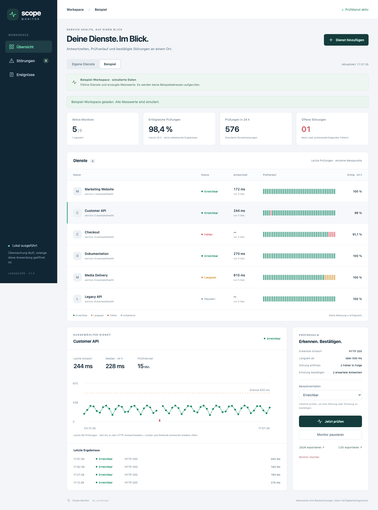
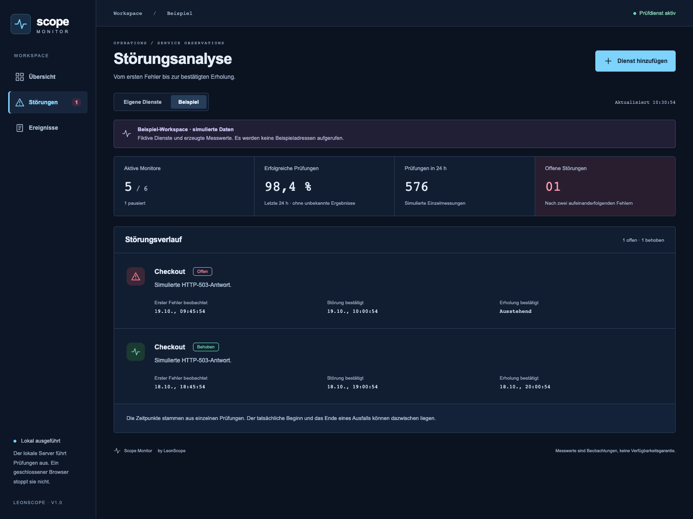
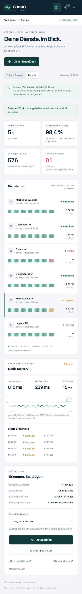

# Scope Monitor

### Check HTTP services and follow their incident history

Scope Monitor checks whether HTTP services respond at regular intervals. Its dashboard shows the latest status and response-time history. Two consecutive failed checks open an incident; two expected responses in a row confirm recovery.

[Deutsch](README.de.md) · [Engineering case study](docs/CASE-STUDY.md) · [Verification record](docs/VERIFICATION.md)

## When an incident is opened

| Check | What happens |
| :--- | :--- |
| First failed check | Preserve the failure in the history. |
| Second consecutive failure | Open one confirmed incident and a local journal entry. |
| First expected response | Record the response; the incident remains open. |
| Second consecutive expected response | Confirm recovery and resolve the incident once. |

An unknown result breaks the sequence. The history records both the first observed failure and the time it was confirmed. Individual checks cannot establish exactly when an outage began.

## Using the monitor

The dashboard distinguishes reachable, slow, failed, unknown and paused services. Selecting a service opens its measurements and check rules. Missing responses remain gaps in the chart.

- **Configure:** public HTTP(S) endpoint, expected status, response-time threshold and a one-, five- or fifteen-minute interval.
- **Operate:** manual check, pause/resume, JSON/CSV export and confirmed deletion with associated history.
- **Inspect:** response-header timing, sample-based success ratios, stale observations and local events.
- **Demonstrate:** six fictional services in a separate example workspace, with selectable failure and recovery scenarios. No example address is fetched.

<strong>Mobile operations view</strong> — services, measurements and controls

## Implementation and tests

**TypeScript · React · Node.js · SQLite · Vite**

On 19 October 2026, **72 application tests and eight browser workflows passed again**. The [test report](docs/VERIFICATION.md) describes the coverage, along with the clean installation and separate real HTTP request from 18 October.

Each observation is saved together with any incident change and journal entry. A pending check cannot add an obsolete result after its monitor has been paused or deleted. DNS addresses and redirects are checked before fetching. The [case study](docs/CASE-STUDY.md) explains these decisions.

I selected this project as the next addition to my portfolio and guided its scope. Codex generated the implementation, interface, tests and documentation and ran the checks. The monitor itself does not use an AI model.

## Running locally

Checks run on the **local server**, even when the browser is closed. When the server is off, there are no measurements, and those gaps are not filled in later. The success ratio describes recorded checks rather than total uptime. Events stay in the local journal; email, webhook and chat notifications are not implemented.

Screenshots contain simulated response times, percentages and incidents. There is no hosted 24/7 service, public application CI or executable download.

**This repository presents the project; application source remains private.** No open-source license, Creative Commons license or general reuse permission is granted for the original material. [Rights notice](RIGHTS.md).
