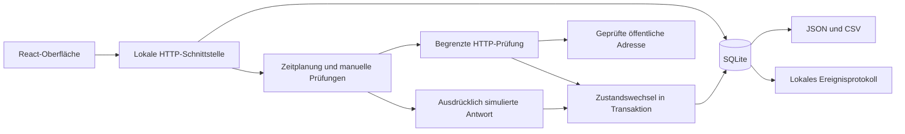

# Fallstudie · Scope Monitor

[Übersicht](../README.de.md) · [English](CASE-STUDY.md) · [Prüfergebnisse](VERIFICATION.de.md)

## Problem und Ergebnis

Eine fehlgeschlagene HTTP-Anfrage ist zunächst eine Beobachtung. Ein hilfreicher Monitor bewahrt diese Beobachtung auf, macht Unsicherheit sichtbar und erklärt Zustandswechsel. Scope Monitor setzt diesen Ablauf in einer kleinen lokalen Anwendung um: Prüfung, Bestätigung, Störungsverlauf und Erholung – mit Funktionen zum Pausieren, manuellen Prüfen und Exportieren.

Die erste Version ist als lokal geprüftes Portfolioprojekt fertiggestellt. Sie wird nicht als betreuter Monitoringdienst betrieben. Quellcode und Implementierungshistorie bleiben privat.

## Zentrale Entscheidungen

| Entscheidung | Grund und sichtbares Verhalten |
| --- | --- |
| Zwei Prüfungen zur Bestätigung | Ein einzelner Fehler eröffnet keine Störung. Zwei Fehler erzeugen eine Störung und einen Protokolleintrag; zwei erwartete Antworten bestätigen einmalig die Erholung. |
| Unbekannte Ergebnisse erhalten | Durch die Zielprüfung blockierte oder intern fehlgeschlagene Prüfungen werden nicht als Erfolg gewertet. Unbekannte Ergebnisse unterbrechen die Bestätigungsfolge und schließen keine offene Störung. |
| Messungen von Verfügbarkeit unterscheiden | Der Erfolgsanteil basiert auf erfolgreichen und fehlgeschlagenen Messungen im vorhandenen 24-Stunden-Fenster. Unbekannte Ergebnisse und fehlende Messungen werden nicht zu Erfolgen umgedeutet. |
| Fehler und Bestätigung getrennt zeigen | Der Verlauf unterscheidet ersten beobachteten Fehler, bestätigte Störung und bestätigte Erholung. Die tatsächlichen Ausfallgrenzen können zwischen Prüfungen liegen. |
| Zustand in SQLite speichern | Prüfung, Störungswechsel und Ereignis werden zusammen gespeichert. Eine Eindeutigkeitsregel verhindert mehrere offene Störungen für denselben Dienst. |
| Veraltete Arbeit ungültig machen | Pausieren und Fortsetzen ändern die Monitorgeneration und verwerfen seine Sperre. Nach einer Löschung kann eine verspätete Antwort keinen Verlauf mehr erzeugen. |
| Regelmäßige Prüfungen begrenzen | Intervalle von einer, fünf oder fünfzehn Minuten, höchstens zwei gleichzeitige Prüfungen im Prozess, 30 Sekunden Sperrzeit und sechs Sekunden Anfragebudget. Nach einem Neustart werden fällige Dienste einmal geprüft. |
| Beispiele getrennt halten | Sechs fiktive Dienste verwenden dieselben Speicher- und Bestätigungsregeln wie echte Prüfungen; ihre Netzwerkantworten werden simuliert. Sie fließen nicht in die Kennzahlen eigener Dienste ein. |

## Architektur

Der Server bindet ausschließlich an die lokale Loopback-Adresse und kontrolliert Host und Herkunft der Anfragen. Die Zielprüfung sperrt private und reservierte Adressen, abweichende Ports, eingebettete Zugangsdaten und URL-Parameter. Jede DNS-Antwort muss öffentlich sein; die Verbindung wird an eine geprüfte Adresse gebunden, der ursprüngliche Hostname bleibt erhalten. Weiterleitungsziele werden erneut geprüft. Verbindungen enden nach Eingang der Antwortheader.

Der Verlauf verwendet die tatsächlichen Messzeitpunkte und verbindet fehlende Antworten und große zeitliche Lücken nicht. Die Oberfläche kennzeichnet veraltete Ergebnisse. Exporte enthalten die Datenquelle; Formelpräfixe werden beim CSV-Export entschärft.

## Umfang und Grenzen

Der lokale Server muss laufen; es wird kein Hintergrunddienst im Betriebssystem installiert. Ein ausgeschalteter oder schlafender Rechner erzeugt Messlücken. Der Browser übernimmt die Zeitplanung nicht. DNS- und TLS-Fehler sind Beobachtungen dieses Rechners und beweisen keinen weltweiten Ausfall.

Bis zu 20 Monitore sind möglich. Pro Monitor werden höchstens 2.000 Prüfungen gespeichert; Einträge älter als sieben Tage werden beim Speichern weiterer Messungen entfernt. Auch abgeschlossene Störungen und Ereignisse werden begrenzt aufbewahrt. Authentifizierte Endpunkte, eigene Ports, Browsertransaktionen, verteilte Messpunkte, E-Mail-Versand und externe Störungsmanagementsysteme gehören nicht zu dieser Version.

Gemessen wird die Zeit bis zu den HTTP-Antwortheadern einschließlich DNS, TLS und Weiterleitungen. Vollständige Seitenladezeit, fachliche Korrektheit einer Anwendung, Zertifikatsablauf und zeitbasierte Verfügbarkeit werden nicht ermittelt. Prozentwerte und Antwortzeiten des Beispiels sind keine Leistungsnachweise.

## Rolle und Nachweise

LeonScope beauftragte das Projekt und legte Portfolioziel und Schutz des Quellcodes fest. Codex erzeugte Implementierung, Gestaltung, Tests und Dokumentation und führte die protokollierten Prüfungen aus. Das Projekt zeigt KI-unterstützte Produktentwicklung und prüfbares Monitoringverhalten. Es beansprucht weder eine vollständig ohne KI geschriebene Implementierung noch KI-Inferenz innerhalb der Anwendung.

[72 Anwendungstests und acht Browserabläufe](VERIFICATION.de.md) bestanden in einer frischen lokalen Installation. Öffentlich sind Prüfumfang und Ergebnisse; der zum Wiederholen der Tests erforderliche Anwendungscode bleibt privat.
