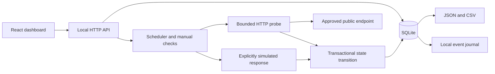

# Case study · Scope Monitor

[Overview](../README.md) · [Deutsch](CASE-STUDY.de.md) · [Verification](VERIFICATION.md)

## Why one failed request does not open an incident

An HTTP request can fail even though the service responds again shortly afterward. Scope Monitor records each check but waits for two consecutive failures before opening an incident. Recovery also needs two expected responses in a row.

The history shows the observations and the resulting status changes. Services can be checked manually, paused and resumed. The application runs locally and is not offered as a managed monitoring service.

## The main decisions

| Decision | Why it works this way |
| --- | --- |
| Confirm with two consecutive checks | One transient failure does not open an incident. Two failures open one incident and one journal entry; two expected responses resolve it once. |
| Preserve unknown outcomes | Policy-blocked or internally failed checks do not become successful observations. Unknown results break confirmation streaks and never resolve an open incident. |
| Separate observations from uptime | Success is calculated from successful versus failed samples over the available 24-hour window, excluding unknowns. There is no invented success for missing data. |
| Separate first failure and confirmation | The timeline records first observed failure, confirmed incident and confirmed recovery. Actual outage boundaries may lie between checks. |
| Store state in SQLite | Checks, incident transitions and event entries commit together. A unique constraint prevents multiple open incidents for one service. |
| Invalidate obsolete work | Pause/resume changes the monitor generation and invalidates its lease. Deleted monitors cannot receive late results. |
| Run a bounded local scheduler | One-, five- or fifteen-minute intervals, at most two simultaneous checks in the process, 30-second leases and a six-second request budget. Restart checks due services without backfilling. |
| Isolate synthetic examples | Six fictional services use the same persistence and confirmation rules as real probes, but their network responses are simulated. They never enter the own-services totals. |

## Architecture

The server binds to loopback and checks Host and Origin on requests. Target validation blocks private/reserved addresses, nonstandard ports, embedded credentials and query parameters. Every DNS answer must be public; the chosen address is pinned to the connection, while the original hostname is retained. Redirect targets are validated again. Connections stop after the response headers arrive.

The history chart uses actual sample timestamps and leaves missing responses and long gaps disconnected. The interface distinguishes the most recent observed state from a stale result. Exports preserve the data source and neutralize spreadsheet-formula prefixes in CSV cells.

## Scope and limitations

The local server must stay running; no operating-system background service is installed. A sleeping or stopped computer produces gaps. Closing the browser does not affect scheduled checks. DNS failures and TLS errors are observations from this machine and do not establish a global outage.

The application allows up to 20 monitors. Check history is capped at 2,000 samples per monitor, with data older than seven days pruned on subsequent recording. Closed incident history and the local event journal are also bounded. No authenticated endpoints, custom ports, browser transactions, distributed probes, email delivery or external incident-management integration are included.

This application measures time to response headers, including DNS, TLS and redirects. It does not measure full page load, application correctness, certificate expiry or duration-based uptime. The synthetic example's percentages and timings are not performance claims.

## My role and the use of AI

I selected the service monitor for my portfolio and guided its scope. Codex generated the application, design, tests and documentation and ran the checks. The monitor itself does not use an AI model.

[72 application tests and eight browser workflows](VERIFICATION.md) passed after a clean installation and again after the interface revision. The report records the environment and dates for each run. Source code remains private.
